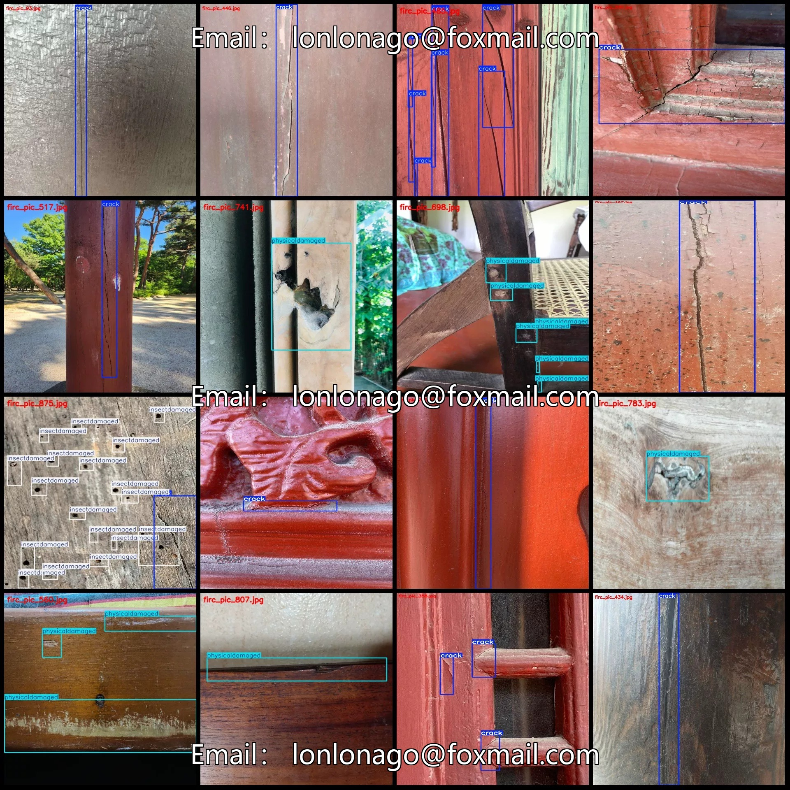
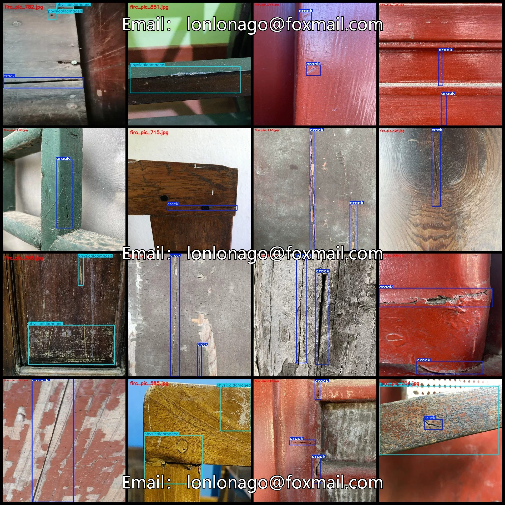
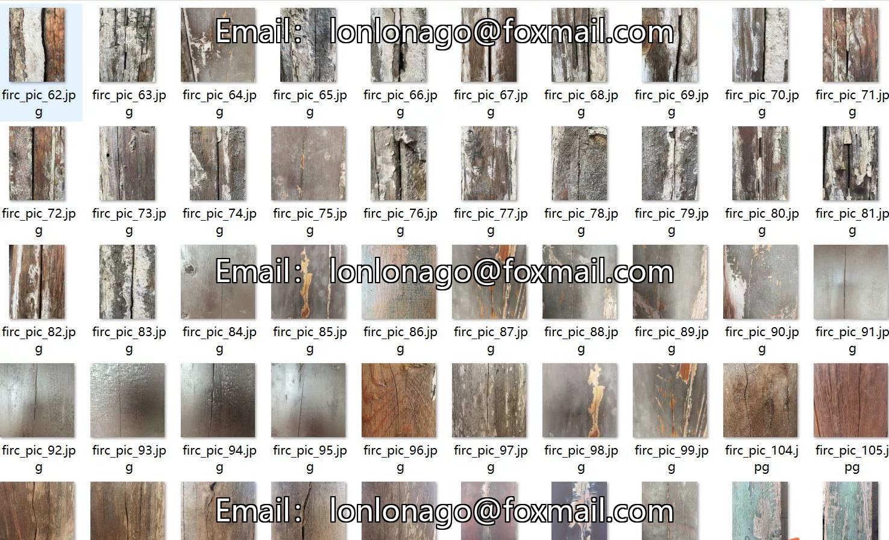
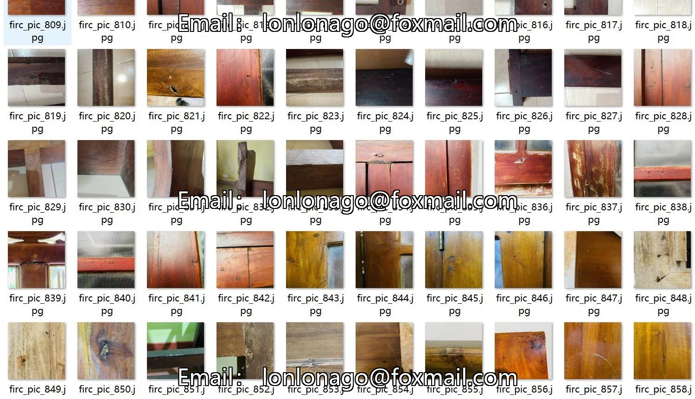
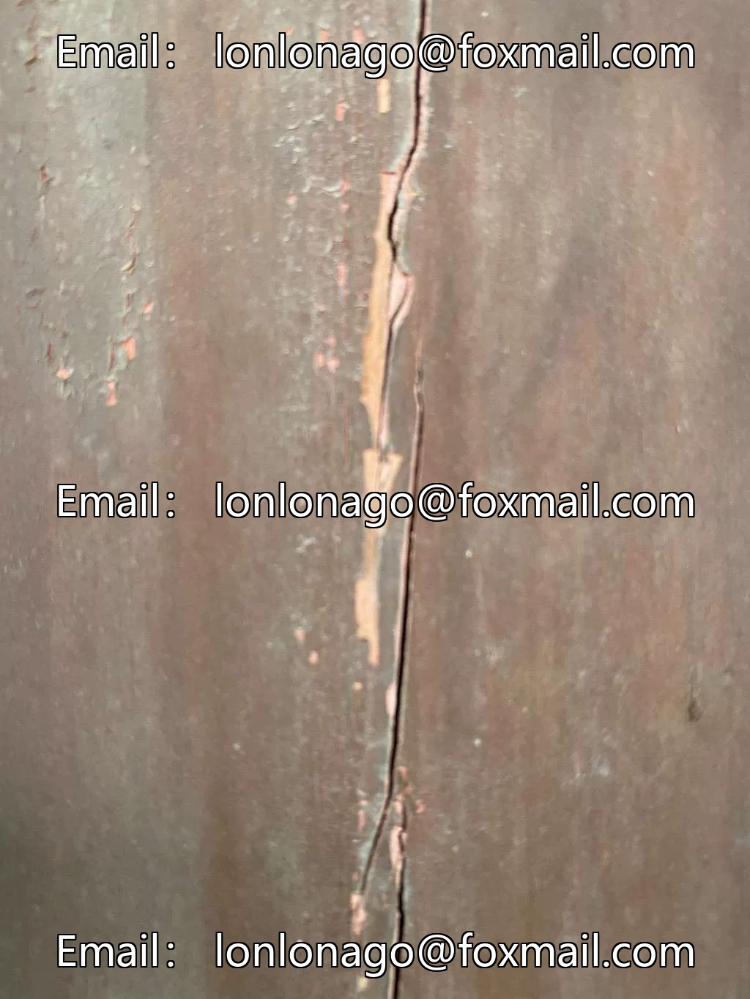
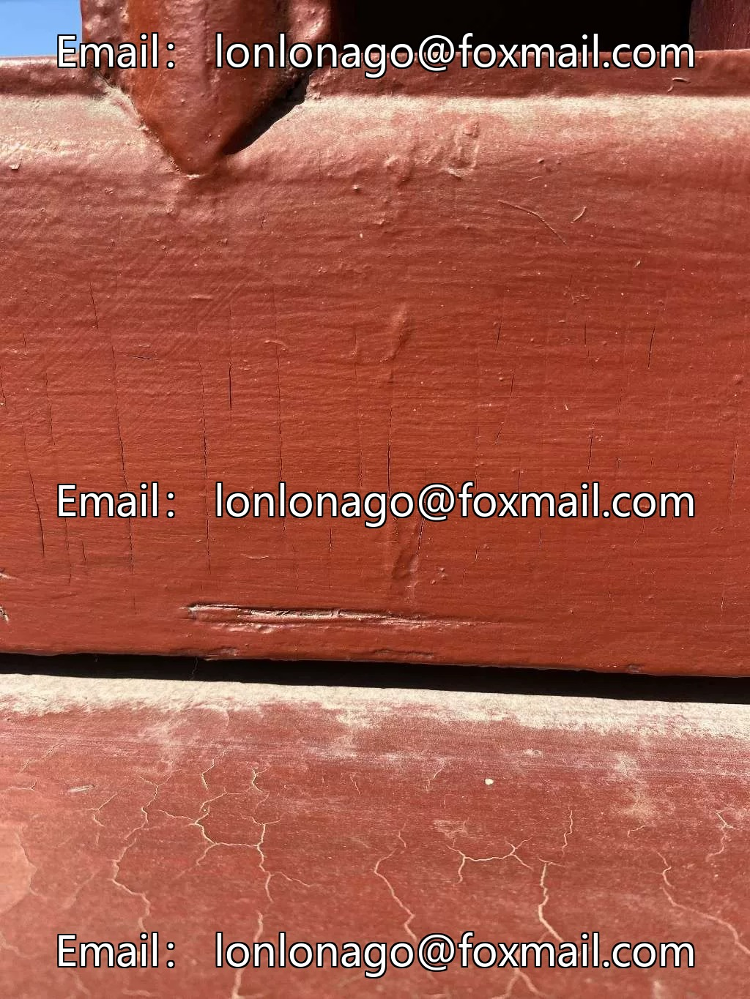
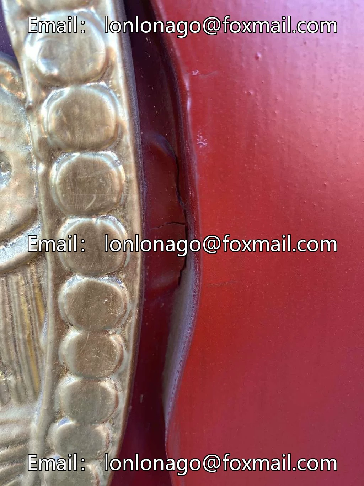

# Voice of Concrete Structures (VOC+YOLO) dataset format: 863 images with 3 categories for ancient architectural wooden structure defect detection

## Body

Architectural wooden structure defect detection dataset VOC+YOLO format: 863 images in 3 categories
Tips: Due to the dataset's replicability, please confirm compliance before purchasing.
Dataset format: Pascal VOC format + YOLO format (txt file without split path, only containing jpg images and corresponding VOC format xml files and yolo format txt files)
Number of images (number of jpg files): 863
Number of annotations (number of xml files): 863
Number of annotations (number of txt files): 863
Number of annotation categories: 3

Annotation Category Names: ["crack", "insectdamaged", "physicaldamaged"]
Number of boxes and images per category:
- Crack (cracks): 1196 boxes, 606 images
- Insectdamaged (insect damage): 371 boxes, 50 images
- Physicaldamaged (physical damage): 723 boxes, 289 images
Total number of boxes: 2290

Image resolution: Multi-resolution images, such as 1024x1365, 640x640, etc.
Using labeling tool: labelImg
Labeling rules: Draw a rectangle around the category.
Important note: The dataset does not have separate training, validation, and test sets; you need to partition them yourself.
Special declaration: This dataset does not guarantee the accuracy of the trained models or weight files.

## Images

## Payment

Here is a pay link on Stripe ( https://buy.stripe.com/3cs8yP7sY87d0vu9AB ). Please contact me lonlonago@foxmail.com after funding $89, and I will send you a complete data files , thank you!

